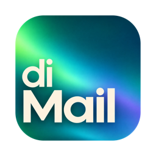
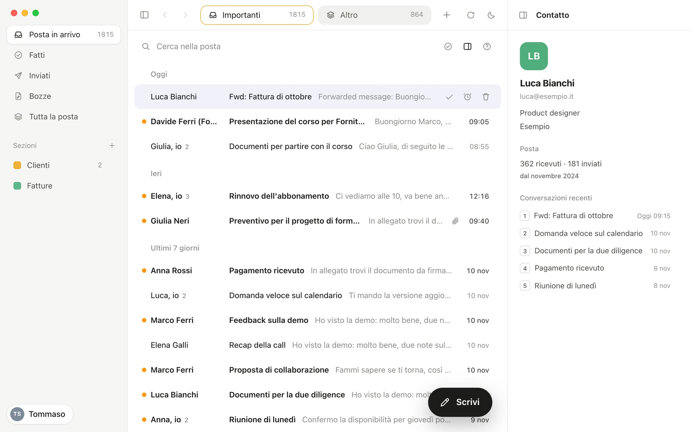
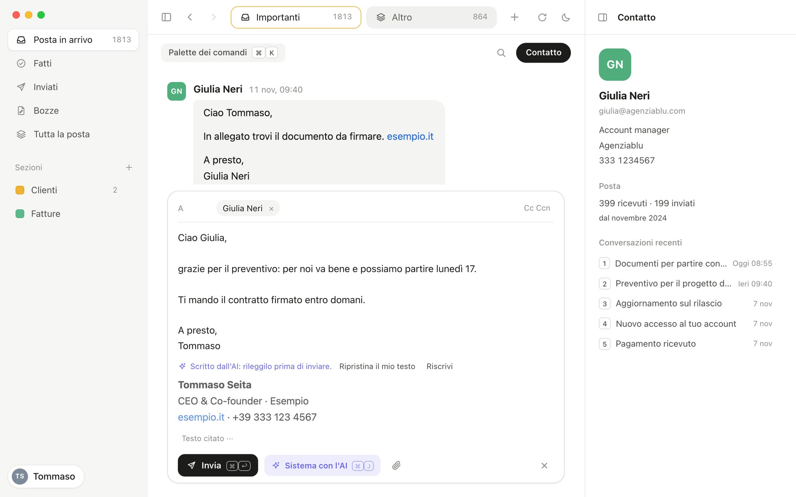

<div align="center">



# diMail

**A Gmail client for the Mac that you drive from the keyboard.**

Your inbox becomes a to-do list, your mail stays on your Mac,
and AI helps without deciding for you.

[Download](https://github.com/tommasoseita/diMail/releases/latest) ·
[Getting started](docs/getting-started.md) ·
[User guide](docs/user-guide.md) ·
[Privacy](docs/privacy.md)



</div>

---

## Why diMail

- **Your mail stays on your Mac.** There is no diMail server and no account to create. The app talks to Gmail directly, with a Google OAuth client that you own, and keeps your mail in a local database.
- **Made for the keyboard.** Everyday actions are single keys, <kbd>⌘K</kbd> opens a command palette with every command, and <kbd>?</kbd> shows the shortcuts.
- **It doesn't make you wait.** The interface reads only from the local database. An action shows at once, goes to Gmail in the background, and <kbd>Z</kbd> undoes it.
- **AI on your terms.** AI is optional and uses your own Mistral or OpenAI key. It receives only the emails you use it on.
- **Open and small.** MIT licensed: a Rust core, a Tauri shell and a React interface you can read and change ([how it's built](docs/architecture.md)).

## What it does

- **An inbox that works as a to-do list.** <kbd>E</kbd> marks a thread as done, <kbd>H</kbd> snoozes it until the time you choose, and a one-time cleanup marks your old threads as done so you start from zero.
- **Important and Other.** The inbox is split in two on your Mac, with no server involved: mail from your own domains and from people you write to stays in Important, newsletters and automatic mail go to Other. Press <kbd>M</kbd> to correct it, for a thread, a sender or a whole domain.
- **Sections.** A section is a Gmail label with instructions for the AI ("invoices and quotes from suppliers"): the AI brings the matching emails there. A section can sit as a tab next to Important and Other.
- **Conversations that read like a chat.** A thread opens on the last message, your messages on the right, without quoted text and signatures until you ask for them.
- **A composer that stays out of the way.** Attachments, your Gmail signature, links made by pasting a URL over selected text, and 30 seconds to undo a send.
- **AI writing with <kbd>⌘J</kbd>.** In the composer, the AI writes the reply or turns your rough notes into an email. You read it before it goes.
- **Search as you type**, over the mail on your Mac, by word prefix and by address.
- **Contact bar, command palette, zoom, light and dark themes**, and the number of conversations in Important on the Dock icon.

<p align="center"></p>

## Requirements

- A Mac, Apple silicon or Intel, with a recent version of macOS.
- A Gmail or Google Workspace account.
- A Google OAuth client. On your own, you create it once in the Google Cloud console, in about ten minutes: see [Creating your Google client](docs/google-client.md). In a company on Google Workspace, one person creates it and sends everyone else a setup link: they open it, confirm and sign in ([how](docs/google-client.md#for-a-company-on-google-workspace)).
- Optional, for the AI features: an API key from [Mistral](https://console.mistral.ai/api-keys) or [OpenAI](https://platform.openai.com/api-keys).

> **The interface is in Italian only for now.** These docs quote each label in Italian, as it appears in the app, with its English meaning.

## Install

1. Download `diMail.dmg` from the [latest release](https://github.com/tommasoseita/diMail/releases/latest).
2. Open it and drag **diMail** to **Applications**, then open it from there.
3. At the first launch, load the JSON file of your Google client, or open the setup link your company sent you, then sign in with Google and wait for the first sync.

The [getting started guide](docs/getting-started.md) walks through each step.

diMail updates itself: new versions are signed, notarized by Apple and verified before they install. It never restarts on its own.

## Build from source

You need macOS, Apple's Command Line Tools, Rust (installed with rustup) and Node 22.

```bash
git clone https://github.com/tommasoseita/diMail.git
cd diMail
npm install
npm run tauri dev             # the app, in development
cargo test -p dimail-core     # the core's tests, sync against a fake Gmail included
npm run check                 # type check of the interface
scripts/build-app.sh          # target/release/bundle/macos/diMail.app, signed locally
```

To work on the interface without touching real mail, run `npm run dev` and open http://localhost:1420 in a browser: outside Tauri the interface runs on a mock backend with invented data.

See [CONTRIBUTING.md](CONTRIBUTING.md) for signing, the mock backend and the checks, and [Architecture](docs/architecture.md) for how the pieces fit together.

## Documentation

| | |
|---|---|
| [Getting started](docs/getting-started.md) | Install, the Google client, sign in, the first sync, turning on AI |
| [Creating your Google client](docs/google-client.md) | Step by step in the Google Cloud console, for one person or for a company on Google Workspace |
| [User guide](docs/user-guide.md) | The inbox, Important and Other, sections, conversations, composing, search, every shortcut |
| [AI](docs/ai.md) | Providers, your key, models, what AI is used for and what is sent |
| [Privacy](docs/privacy.md) | Where your mail is stored, what leaves your Mac and where it goes |
| [Troubleshooting](docs/troubleshooting.md) | Keychain prompts, Google sign-in screens, logs, starting over, updates |
| [Architecture](docs/architecture.md) | The Rust core, the Tauri shell, the React interface, the tests |
| [Releasing](docs/releasing.md) | For maintainers: signing, notarization and updates |

Organizations, where a company server sets everything up for colleagues, are planned and will use [diServer](https://github.com/tommasoseita/diServer).

## Contributing

Bug reports, ideas and pull requests are welcome: please read [CONTRIBUTING.md](CONTRIBUTING.md) and our [Code of Conduct](CODE_OF_CONDUCT.md). Security issues: see [SECURITY.md](SECURITY.md), and please don't open a public issue.

## License

diMail is released under the [MIT License](LICENSE). Copyright © 2026 Tommaso Seita.
